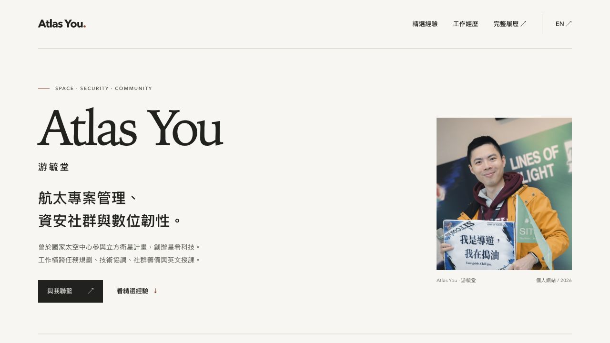

# Atlas You Personal Website

個人網站，整理航太專案管理、衛星通訊、資安社群、數位韌性培訓與國際協作經驗。
中英文首頁以「個人介紹、工作領域、精選經驗、工作經歷、教育研究、得獎與完整經歷、聯絡」呈現內容。
得獎、演講、社群、其他專案、著作、教育、培訓、語言與能力直接展開於首頁下方，可用段落導覽跳轉。`resume.html` 與 `en/resume.html` 另保留文件式履歷入口。



## Online

- GitHub Pages: https://atlasforcn.github.io/atlas-home/
- English homepage: https://atlasforcn.github.io/atlas-home/en/

由 GitHub Pages 從 `main` 分支的根目錄發布。

## Local Preview

```bash
python3 -m http.server 8000 --bind 127.0.0.1
```

Open `http://127.0.0.1:8000/` in a browser.
中英文首頁包含預先產生的完整履歷細節，停用 JavaScript 仍可閱讀與跳轉段落。文件式履歷透過 JavaScript 讀取 Markdown，請使用本地伺服器預覽；另提供文字版本連結。

- 中文首頁：http://127.0.0.1:8000/
- 英文首頁：http://127.0.0.1:8000/en/
- 中文履歷：http://127.0.0.1:8000/resume.html
- 英文履歷：http://127.0.0.1:8000/en/resume.html

## Content

- `index.html`、`en/index.html`: 中英文單頁網站，包含精選內容與完整履歷細節
- `home.css`、`home.js`: 首頁響應式樣式與 Email 複製功能；不依賴外部字型或套件
- `resume.html`、`en/resume.html`: 中英文完整履歷頁
- `resume.css`: 完整履歷的桌面、手機與列印樣式
- `resume.md`: 履歷內容來源
- `resume-en.md`: English resume content source
- `assets/profile-portrait.jpg`: 中英文履歷使用的 528 × 528 壓縮頭像；`profile_picture.jpg` 保留作為原圖
- `assets/certificates/nasa-arset-remote-sensing.pdf`: NASA ARSET Fundamentals of Remote Sensing 完課證書
- `style.css`: 舊文章與主題預覽保留的樣式
- `script.js`: 共用 Markdown 載入與渲染；首頁 details 模式省略已顯示的介紹、工作經歷與專題說明，並保留不重複的段落錨點
- `scripts/build-resume.mjs`: 使用同一份渲染邏輯，將 Markdown 履歷細節預先寫入中英文首頁
- `sitemap.xml`: 中英文主要網址與語言對應，供搜尋引擎探索
- `.nojekyll`: 以一般靜態檔案方式發布 GitHub Pages
- `blog/`, `post.html`, `timeline.json`: 舊版部落格與時間軸資料，首頁目前未載入

首頁上半部為人工精選的靜態內容，修改重要日期、職稱、成果時，請同步更新兩個首頁及兩份 Markdown 履歷。首頁下方細節與文件式履歷共用 Markdown 來源。修改 Markdown 後，發布前執行：

```bash
node scripts/build-resume.mjs
node scripts/build-resume.mjs --check
```

產生的 HTML 一併提交至 `main`；GitHub Pages 直接發布，不需安裝套件。

## Search visibility

中英文首頁設定標題、摘要、canonical、互相對應的 hreflang、允許索引的 robots meta，以及 ProfilePage / Person 結構化資料。文件式履歷的 canonical 指向各語言首頁，避免相同內容分散於多個主要網址。完整履歷直接存在 HTML 中，搜尋引擎不需執行 JavaScript 才能讀到。

網站地圖：https://atlasforcn.github.io/atlas-home/sitemap.xml

Google Search Console 網址前置字元資源 `https://atlasforcn.github.io/atlas-home/` 已透過首頁 meta tag 驗證；維護時請保留驗證標籤。2026-10-13 檢查時中文首頁已編入索引，英文首頁已通過線上測試並提交索引要求；網站地圖雖已提交，報表仍顯示「無法擷取」，尚待確認後續處理結果。已收錄不表示姓名搜尋一定顯示，也不保證排名。

人物資料以同一個 `Person.@id` 串連兩種語言，`alternateName` 列出實際使用的「游毓堂」、「Atlas」與 GitHub 帳號「atlasforcn」。簡介與可見內容一致，`sameAs` 僅列本人帳號；活動團隊頁保留為經歷證據，不當成個人帳號。首頁提供可見的 GitHub 連結與 `rel="me"`；這些設定表達身分關聯，不代表 Google 排名加分保證。

語言切換與履歷返回首頁的連結直接指向 canonical 路徑。網站地圖的 `lastmod` 記錄實際內容或結構化資料的重要更新日期，不要每次建置自動改成當天。`theme-preview.html` 是設計用頁面，設為 `noindex`。

GitHub Pages 專案位於子路徑，`robots.txt` 只在網域根目錄有效，因此本專案不放置無效的子目錄 robots 檔案。Google 的網站名稱功能不支援子目錄，所以不為了這個功能增加 `WebSite` 標記。Google 不使用 `meta keywords` 進行索引或排名，也不加入隱藏關鍵字。

### Personal-site comparison — 2026-10-13

直接檢查官方首頁 HTML；以下是實作觀察，不能用來判定其搜尋排名的原因。

| 網站 | 本次觀察 | 採用的原則 |
| --- | --- | --- |
| [Andrej Karpathy](https://karpathy.ai/) | 姓名 title 與 h1、清楚的簡介及本人帳號連結；首頁未見 description 或 JSON-LD。 | 可見內容與真實經歷比增加標籤數量重要。 |
| [Derek Sivers](https://sive.rs/) | 有 description、canonical、Person / WebSite JSON-LD，並以 sameAs 與 rel=me 連到本人帳號。 | 用人物結構化資料連結可確認的身分，避免直接照抄獨立網域的設定。 |
| [Simon Willison](https://simonwillison.net/about/) | 首頁提供 canonical、author、rel=me 與 About 入口；About 有清楚的簡介和社群帳號。 | 讓讀者與搜尋引擎都能找到一致的姓名、簡介和帳號。 |

維護依據：[Google ProfilePage](https://developers.google.com/search/docs/appearance/structured-data/profile-page)、[支援的 meta tags](https://developers.google.com/search/docs/crawling-indexing/special-tags)、[Sitemap 與 lastmod](https://developers.google.com/search/docs/crawling-indexing/sitemaps/build-sitemap)、[網站名稱的適用範圍](https://developers.google.com/search/docs/appearance/site-names)。

## Design references

- [Andrej Karpathy](https://karpathy.ai/)：清楚區分個人簡介、經歷與作品，使用直接的內容連結。
- [Derek Sivers](https://sive.rs/)：精簡導覽與易於閱讀的資訊結構。

本版採暖白底色、墨色文字、少量赭紅、細分隔線與留白；沿用本人照片，沒有新增模擬作品圖或合作品牌背書。

## Content review — 2026-10-13

以現有中英文履歷為內容基礎；未將沒有逐項佐證的內容描述為已獨立查證。

| 項目 | 本版處理與證據 |
| --- | --- |
| TASA 任職日期 | 採履歷更新的 2022.12–2026.06，不使用舊時間軸的「至今」。 |
| 6U 大學專題 | 依本人補充，參與當時的大學專題；後續專案成為旺來衛星，由其他教授在之後幾年推進。專案後續發展段落附上 2026 AIAA 年度小衛星任務獎及[官方公告](https://arkedgespace.com/en/news/2026-08-28_ssmoty)（公告日期 2026-08-31）；獎項指旺來任務，不列入本人的得獎清單。 |
| 社群總召 | [HITCON CMT 2024 官方團隊](https://hitcon.org/2024/CMT/team/)與 [SITCON 2021 官方團隊](https://sitcon.org/2021/team)均列 Atlas 為總召。依本人偏好聚焦籌備與協調，不強調轉線上或觀看數。 |
| iGEM | 完整履歷改為「iGEM 團隊金牌」，去除容易誤解成 MIT 團隊或學歷的稱呼。[官方結果](https://competition.igem.org/results/2019?tab=medals)列 NCTU_Formosa 金牌；不宣稱唯一冠軍。 |
| 授課與交流 | 五天工作坊中教授六堂英文課、法國觀察及報告完成狀態，均依使用者履歷，未另加受訓人數或成效。 |
| 尚待補充佐證 | TEDx 活動名稱／影片、部分競賽獎項及個人分工，可在取得原始資料後補連結；目前依本人履歷記載，未增加成效數字。 |
| 研究提案與課程 | UMAL 保留為研究／投稿方向；NASA ARSET 為課程完課證明，不描述為 NASA 任職或專業執照。 |
